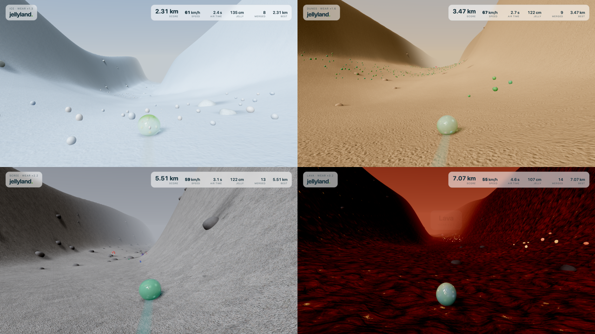

# Jellyland

An endless downhill for one small jelly. The hill never ends and never repeats,
and the jelly never stops.


Rolling wears the jelly away. Roll into the things that grow in patches down
the valley to merge with them: each one is pulled in with a plop, and the jelly
grows and takes on its colours, patterns and lumps. With nothing to eat a jelly
shrinks to nothing, and bigger jellies wear faster. The faint slime trail
behind it is the jelly it is losing. Top speed is 100 km/h.

The run passes through five biomes, 1.5 km each, blending into one another
over 200 m. Each has its own ground, light, terrain and thing to eat, and each
wears the jelly faster than the last:

| Biome | Wear | To eat | Character |
| --- | --- | --- | --- |
| Meadow | ×1 | jelly mushrooms | a mild clear day |
| Ice | ×1.25 | snowballs | bright, wide, slippery |
| Dunes | ×1.6 | cacti | big rolling swells under a gold sun |
| Scree | ×2.2 | crystals | narrow, rough, rocky, overcast |
| Lava | ×3.2 | embers | night, lit by glowing cracks |



After the lava the sequence starts again with every wear rate half as high again.

Now and then a red magnet floats above the grass. Roll or fly through it and
for ten seconds every mushroom within nine metres is pulled in.

**Scores:** distance covered, and air time (total seconds off the ground).

## Play

```sh
npm install
npm run dev
```

Open the printed URL in a WebGPU browser (Chrome, Edge, Safari 26+). There is no
WebGL fallback; an unsupported browser gets an error card, not a black canvas.
Sound starts on your first key press.

| Key | Does |
| --- | --- |
| `W` / `↑` | accelerate |
| `S` / `↓` | decelerate (never to a stop: the jelly cannot be stopped) |
| `A` / `←` | steer left |
| `D` / `→` | steer right |
| `Space` | jump (and roll again once worn away) |
| `R` | restart from the top |
| `M` | mute |
| `?` | show or hide the controls in the game |

## How it is put together

- `src/game/` is the whole simulation and has no rendering imports: the terrain
  as a pure height function, the biome sequence, hashed rock, collectible and
  magnet placement, the rolling-ball physics, wear and growth, and the jelly's
  wobble springs.
  `src/game/tuning.ts` holds every gameplay number.
- `src/world/` draws it: pooled terrain chunks refilled from the height
  function, instanced rocks and mushrooms, the deforming jelly (with the lobes
  of whatever it has absorbed), merge droplets, the slime trail, sky, chase
  camera, and a floating render origin so precision holds at any distance.
- `src/render/` is the renderer adapted from
  [Jelly Baby](https://github.com/scottstts/Jelly-Baby): WebGPU setup and
  failure policy, HDR environment, transmissive jelly material, local
  reflection probe, bloom and grade. It also holds the jelly colours and looks.
- `src/audio/` synthesises the effects with ZzFX (each kind of collectible
  merges with its own sound) and plays a background drone on the JP-8 synth,
  a Rust/WASM engine in an AudioWorklet, whose filter opens with speed.
- `src/app/` is input, HUD and the frame loop.

## Checks

```sh
npm test    # simulation invariants (node --test)
uv run --with playwright scripts/drive.py http://localhost:5173/ shots "wait:2,shot:start,snap"
```

The second command drives the running dev server in real Chrome with real key
presses, writes screenshots, and prints the game state; see the docstring in
`scripts/drive.py`.

## Licence

GPL-3.0-only (see `LICENSE`). Jellyland is a derivative of Jelly Baby by Scott
Sun; `NOTICE.md` lists exactly which files are adapted and from where, including
the Apache-2.0 JP-8 engine.
