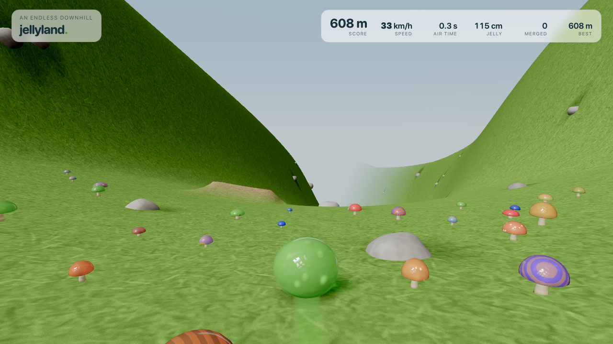
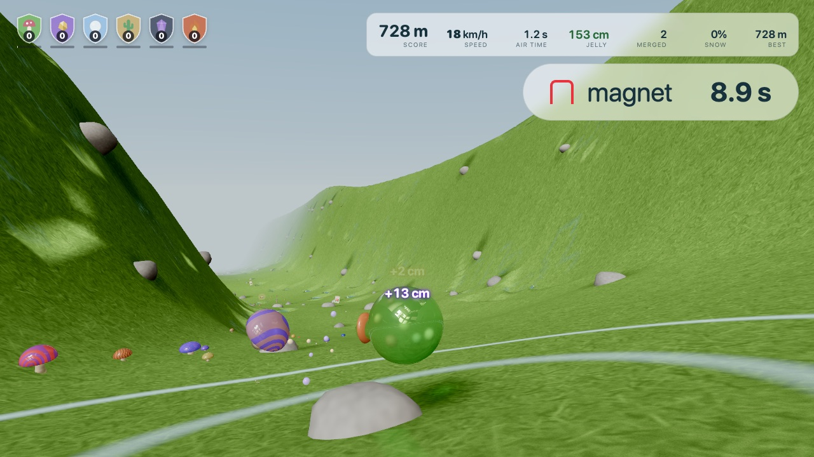
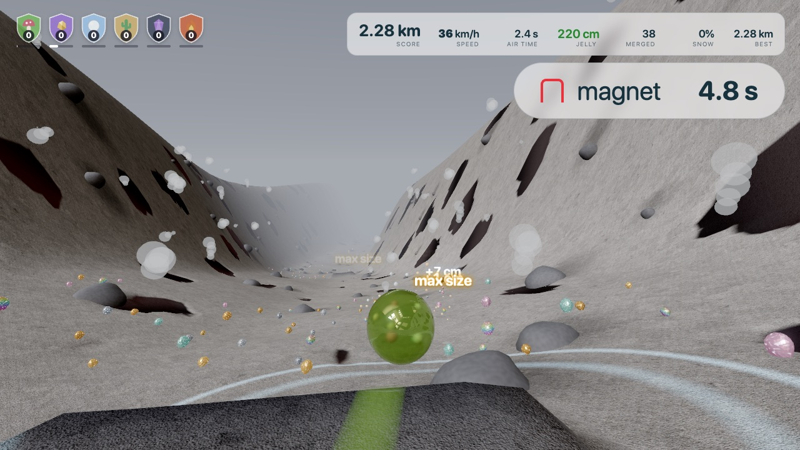
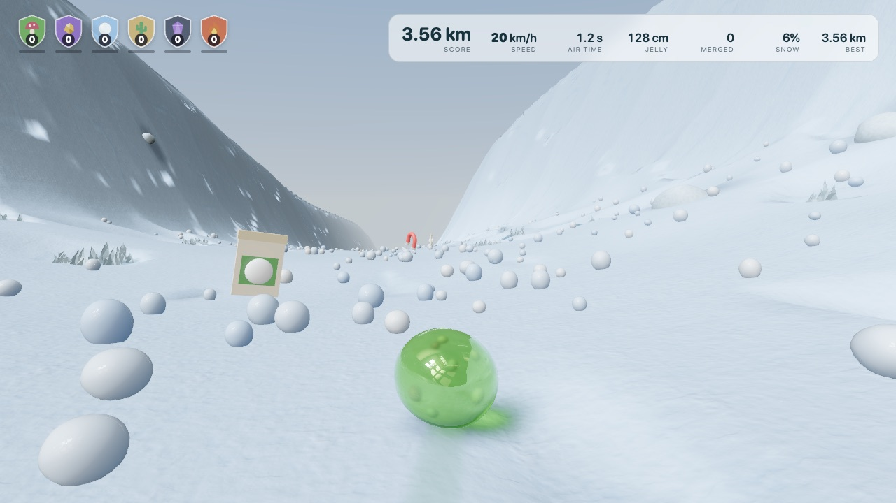
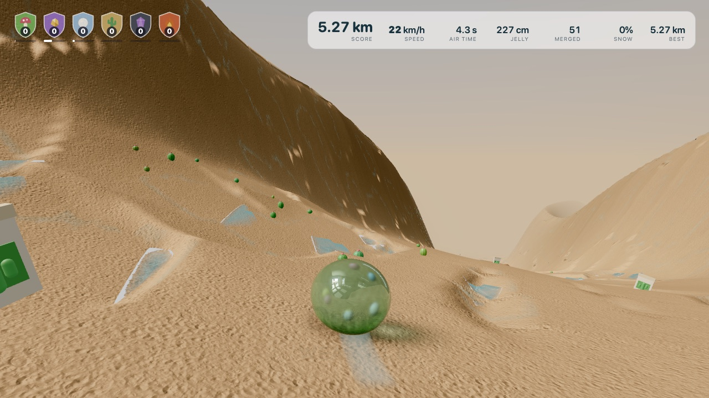
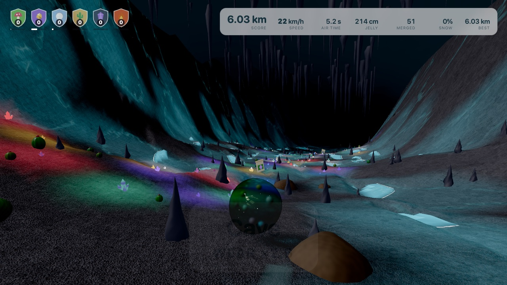
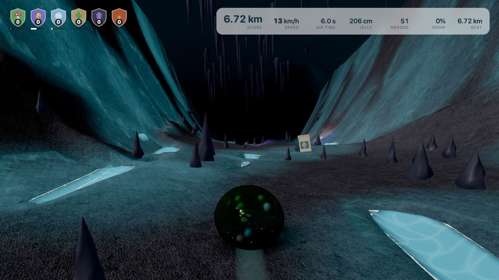
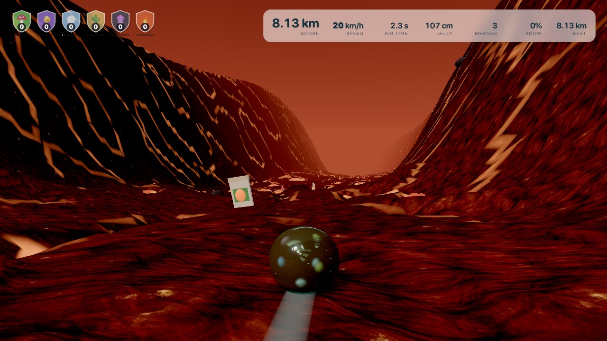
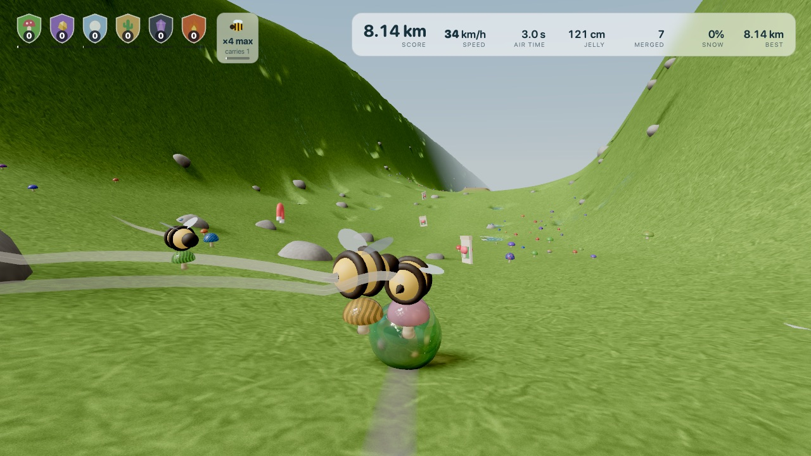
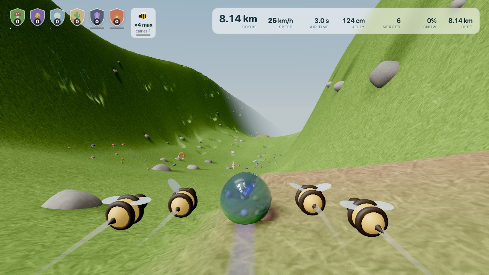

# Jellyland

An endless downhill for one small jelly. The hill never ends and never repeats,
and the jelly never stops.



Rolling wears the jelly away. Roll into the things that grow in patches down
the valley to merge with them: each one is pulled in with a plop, and the jelly
grows and takes on its colours, patterns and lumps. With nothing to eat a jelly
shrinks to nothing, and bigger jellies wear faster. The faint slime trail
behind it is the jelly it is losing. Top speed is 150 km/h; it takes a lot of W
and a good drop to get there.

The run passes through six biomes, 1.5 km each, in the order below, blending into one another
over 400 m. Each has its own ground, light, terrain and thing to eat, and its own wear:

| Biome | Wear | To eat | Character |
| --- | --- | --- | --- |
| Meadow | ×1 | jelly mushrooms | a mild clear day |
| Scree | ×2.2 | ore: gold, silver, opal | narrow, rough, rocky, overcast |
| Ice | ×1.25 | snowballs | bright, wide, slippery; snow packs onto a fast jelly |
| Dunes | ×1.6 | cacti | big rolling swells under a gold sun |
| Cave | ×2.6 | glowing crystals | dark; lit only by the crystals and the glowing pools; stalagmites and stalactites everywhere |
| Lava | ×3.2 | embers | night, lit by glowing cracks |

| | |
| --- | --- |
|  Meadow |  Scree |
|  Ice |  Dunes |
|  The mouth of the cave |  Inside the cave |
|  Lava | |

After the lava the sequence starts again with every wear rate half as high
again, and the jelly's minimum and default speeds 20% higher.

### Holes

From about 220 m the ground starts to have holes in it, a different kind in each
biome. They begin small and sparse, and every biome passed makes them bigger and
more joined up, and they hurt up to twice as much by the time they have finished growing. None of them is instant death: each takes a little jelly at a
time, and none can slow the jelly below its minimum speed.

| Biome | Hole | What it does |
| --- | --- | --- |
| Meadow | pond | huge friction, melts the jelly fast |
| Ice | ice shards | each shard stabs and tears a piece off |
| Dunes | oasis | like a pond |
| Scree | steam vents | burn the jelly and throw it into the air, perhaps onto the next vent |
| Cave | glowing pool | like a pond |
| Lava | lava | burns hard and slows the jelly a lot |

Three lanes down the valley are always kept clear, however narrow they get, so
there are always three ways through. Holes cover the banks up to the ridge, so
riding the wall is no way round. A jump clears a small hole.

### The cave

The valley ends at a mountain, and a giant cave opens in its foot. The mountain is the ground itself (the banks rise into
it); the cavern is far wider than the valley floor and many times as high, with an uneven vaulted roof that swells and sags,
and stalactites up to 24 m long hang from it. Nothing about it is regular. It is dark:
there is no sky, and the only light is what glows. The crystals (they used to grow in the scree, which
now has ore: gold, silver and opal) glow, and each lights the floor round it in its own colour; so do the pools. Stalagmites stand all over the floor and the
jelly bounces off them like posts. Stalactites hang over it, and about one in five lets go as the jelly comes: it is timed
to come down where the jelly is heading, cracks as it goes, and takes 7% of the jelly and a good deal of its speed if it
strikes. A glass marble is not hurt by them, and knocks stalagmites over as it knocks rocks to pieces.

Two power-ups float above the grass now and then:

- **Magnet** (red horseshoe): for ten seconds every collectible within nine
  metres is pulled in.
- **Seed packet**: sprays a pile of seeds in arcs down the valley ahead. They
  land and sprout at once into the collectible of the ground they landed on,
  ready to roll through.

Two more floating things turn up now and then:

- **Glass marble** (a clear ball with a twist of colour; none turn up before the
  second biome, and then one biome in two): for twenty-four seconds the
  jelly is a glass marble, polished and rigid, and nothing wears or melts it. It
  rolls with a recording of stone sliding on stone, louder the faster it goes, and
  hits like a boulder on rock: rocks it hits smash into pieces and it rolls on.
- **Bee**: about one biome in two has a bee floating in it (the first is in the
  first meadow). Roll through it and it joins you, up to four. A bee flies out,
  picks a collectible nearby and brings it back; the jelly absorbs it as if it had
  rolled through it. A level 1 bee carries one at a time. With nothing to fetch a
  bee flies beside the jelly, the way a dog heels. Bees are small and fast and
  leave contrails.

| | |
| --- | --- |
|  Bringing mushrooms back |  Heeling |

The seed packet's label shows what it grows where the seeds will land: a
mushroom in the meadow, ore in the scree, a snowball on the ice, a cactus in the
dunes, a crystal in the cave, an ember in the lava.

**Shields.** A row of badges at the top left, one shield per biome, each showing
that biome's collectible and a level, all 0 to begin with. Every collectible of
a kind fills its shield: 100 take the shield to level 1, 200 more to level 2, 300
more to level 3. Level 1 takes 10% off that biome's wear, level 2 30% and level
3 60%. Bees have the same ladder, counted in what they bring in: 100 make them
carry two, 200 more three, 300 more four, 400 more five. Shields and bees start
again with each run.

**Damage.** Each gain shows as a green "+N cm"; what a hazard takes (water, spikes,
steam, lava) is added up and shown as a red "−N cm" that drops away from the
jelly. Ordinary rolling wear is not shown: it would be constant noise.

Each merge plays out like two jellies melting together: the collectible presses
against the jelly and flattens, a smooth neck blends them as it sinks in, its
colour spreads through the jelly, and the jelly swells and wobbles. A small
"+N cm" shows how much the jelly grew.

**Scores:** distance covered, and air time (total seconds off the ground).

## Play

```sh
npm install
npm run dev
```

Open the printed URL in a WebGPU browser (Chrome, Edge, Safari 26+). There is no
WebGL fallback; an unsupported browser gets an error card, not a black canvas.
Sound starts on your first key press.

| Key | Does |
| --- | --- |
| `W` / `↑` | accelerate |
| `S` / `↓` | decelerate (never to a stop: the jelly cannot be stopped) |
| `A` / `←` | steer left |
| `D` / `→` | steer right |
| `Space` | jump (and roll again once worn away) |
| `R` | restart from the top |
| `M` | mute |
| `?` | show or hide the controls in the game |

### On a phone

Controls appear on touch screens: a translucent joystick on the left (up
accelerates, down decelerates, left and right steer), a large jump button on the
right (it also rolls again once worn away), and two small buttons for tilt
steering and sound. Tap the tilt button to steer by tilting the phone; the
position it is held in when you tap becomes "straight", and it works in portrait
and landscape. iOS asks for motion permission the first time. Sound starts on
your first touch, and the screen is kept awake while you play.

WebGPU needs a secure page, so a phone must load the game over HTTPS (a deployed
site or a tunnel); plain `http://<LAN address>` will report no WebGPU.

## Deploy

A production build is plain static files: HTML, JavaScript, images and two
small binaries. There is no server code.

```sh
npm install
npm run build      # writes the site to dist/
npm run preview    # optional: serve dist/ locally to check it
```

Upload the contents of `dist/` to any static host. Two things the host must do:

- serve over **HTTPS** (WebGPU and audio worklets need a secure context;
  `localhost` also counts);
- nothing else. No special headers are needed, and asset paths are relative,
  so the site works from a sub-folder as well as from the root.

Needs Node 20.19 or newer (Node 22 recommended) to build.

### Replit

The repository includes a `.replit` file:

- **Run** starts the dev server (`npm install && npm run dev`) on port 5173.
- **Deploy** as a **Static** deployment: build command
  `npm install && npm run build`, public directory `dist`.

If Replit asks for these in its deployment form instead of reading the file,
enter the same build command and public directory.

## How it is put together

- `src/game/` is the whole simulation and has no rendering imports: the terrain
  as a pure height function, the biome sequence, hashed rock, collectible and
  magnet placement, the holes (`hazards.ts`), the rolling-ball physics, wear and growth, and the jelly's
  wobble springs.
  `src/game/tuning.ts` holds every gameplay number.
- `src/world/` draws it: pooled terrain chunks refilled from the height
  function, instanced rocks and mushrooms, the shards, steam and bubbles of the holes, the deforming jelly (with the lobes
  of whatever it has absorbed), merge droplets, the slime trail, sky, chase
  camera, and a floating render origin so precision holds at any distance.
- `src/render/` is the renderer adapted from
  [Jelly Baby](https://github.com/scottstts/Jelly-Baby): WebGPU setup and
  failure policy, HDR environment, transmissive jelly material, local
  reflection probe, bloom and grade. It also holds the jelly colours and looks.
- `src/audio/` plays recorded CC0 sounds for merges (a random recipe per kind of
  collectible, with slight pitch variation) and landings; the jump, magnet, seed
  packet, lava ember and the sounds of the holes are synthesised with ZzFX; a drone runs on the JP-8 synth,
  a Rust/WASM engine in an AudioWorklet, whose filter opens with speed.
- `src/app/` is input, HUD and the frame loop.

## Checks

```sh
npm test    # simulation invariants (node --test)
uv run --with playwright scripts/drive.py http://localhost:5173/ shots "wait:2,shot:start,snap"
```

The second command drives the running dev server in real Chrome with real key
presses, writes screenshots, and prints the game state; see the docstring in
`scripts/drive.py`.

## Water

The water in the holes is drawn by one shader (`src/water/material.ts`) that reads the scene behind it: what is under the
water is bent by the surface and darkened and tinted by how deep the water is, the shore thins out and foams where the water
gets shallow, and the sky and sun lie on top. The ripples (`sim.ts`) are a simulated wave grid, the splash (`spray.ts`) is a
crown, a jet, droplets, foam and mist, and `src/world/water-interaction.ts` is what the jelly does to them.

Every setting of it is in `src/water/params.ts`. **Processor intensity** (0 to 100) sets how much work the water does: it
picks one of four tiers (ripple grid size, surface triangles, how many steps the shader takes, how much spray). At load the
game runs a half-second benchmark of the real scene and picks the intensity and render scale this device can hold 60 fps
at (`?intensity=NN` skips it).

Liquid is level. A pool has one surface height, the lowest point of its rim; its water exists only inside its own outline
and only where the ground is below that height, and everything else of the surface sits under the ground, so on a hill no
sheet of water can hang in the air (`src/game/water-shore.ts`, with a test). Where a neighbouring pool has cut the ground
along a rim, the rim is built back up to the pool's surface as a ridge.

### Water designer

```sh
npm run dev      # then open http://localhost:5173/water-designer.html
```

A separate page for designing the water: a pool, a jelly to drop or throw in, click-to-splash, rain, quick sliders
(processor intensity first) and a slider for every detailed setting. It needs a WebGPU browser. "Copy settings" gives the
values as JSON; "Use in game" keeps them in this browser, and the game reads them at load.

## Licence

GPL-3.0-only (see `LICENSE`). Jellyland is a derivative of Jelly Baby by Scott
Sun; `NOTICE.md` lists exactly which files are adapted and from where, including
the Apache-2.0 JP-8 engine.
